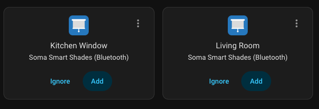

# Soma Smart Shades for Home Assistant

Control [Soma Smart Shades 2 and Tilt 2](https://www.somasmarthome.com/) over Bluetooth LE from Home Assistant, without
the SOMA Connect hub, an MQTT broker or a separate bridge. The Smart Shades 3 are not supported.

```
┌──────────────┐               ┌──────────────────────┐
│ Soma Smart   │ Bluetooth LE  │ Home Assistant       │
│ Shades       │◄─────────────►│ connection per shade │
│              │               │ keepalive, reconnect │
└──────────────┘               └──────────────────────┘
```

Every shade is a device with:
- a cover with live position updates, for a Tilt with the tilt position: closed downwards at 0, open at 50 and closed
  upwards at 100, as in the SOMA Connect integration
- battery, charging and connection sensors
- *Identify* and *Sync time* buttons
- a *Bluetooth connection* switch

## Installation
1. Under *Settings > Marketplace*, search for *Soma Smart Shades* and install it. On Home Assistant 2026.10 or older,
   use HACS and restart Home Assistant afterwards.
2. Add the discovered shades, or add one under *Settings > Devices & services > Add integration > Soma Smart Shades*.



## Bluetooth
A connection to every shade stays open, for a fast response. Each one takes a connection slot of the adapter, shared
with your other Bluetooth devices, so
[choose a good adapter](https://github.com/vanderkley/soma-shades#bluetooth-adapter).

Is Home Assistant out of range of the shades? Run the
[MQTT bridge](https://github.com/vanderkley/soma-shades#mqtt-bridge) on a device closer to them, e.g. a Raspberry Pi.

## Soma app
A shade accepts a single connection. To configure it in the Soma app, turn off its *Bluetooth connection* switch. It
stays free, also after a restart, until you turn the switch on again.

## Credits
Built on the [soma-shades](https://github.com/vanderkley/soma-shades) library.
